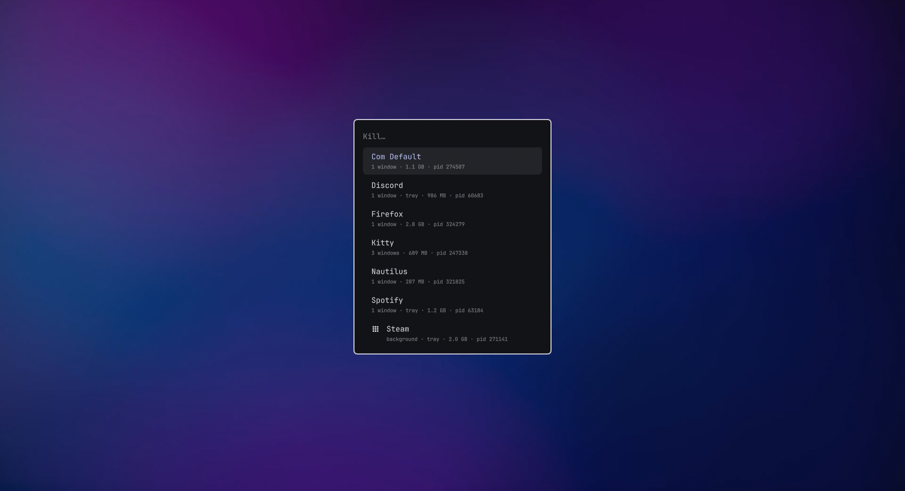

# omakiller



A kill menu for Omarchy. Opens a picker in the Omarchy launcher listing your
running apps (windows, tray icons, and background apps), and pressing Enter
kills the selected one.

## Features

- Shows each app once, even apps that run many processes (Steam, Discord, Electron apps)
- Shows window count, tray status, and memory use for each app
- Tries a clean shutdown first (SIGTERM), then force-kills anything left after 3 seconds
- Never lists the desktop itself: Hyprland, the Omarchy shell, audio, portals, etc.
- Custom ignore list for anything else you want hidden

## Requirements

- Omarchy 4 (uses `omarchy-menu-select` and `omarchy-notification-send`)
- Python 3

## Install

```
omarchy plugin add https://github.com/maninthecity/omakiller.git --enable

```
```
The omakiller icon appears in your bar. Click it to open the picker.
```

Add a keybind to `~/.config/hypr/bindings.lua`:

```lua
o.bind("SUPER + SHIFT + K", "Kill app", "omakiller")
```

### Add it to the Omarchy menu (optional)

Open `~/.config/omarchy/extensions/omarchy-menu.jsonc` and add this line
inside the outer `{ }`:

```jsonc
"kill": {"icon":"󰆴","label":"Kill","description":"Stop a running or background app","action":"omakiller"},
```

Then run `omarchy restart shell`. Kill will show up in the Omarchy menu

## Usage

```
omakiller           open the picker (stays open until you press Escape)
omakiller --list    print detected apps and exit
```

**Note:** pressing Enter kills the app immediately with no confirmation.

## Ignoring apps

Add names to `~/.config/omakiller/ignore`, one per line:

```
# apps omakiller should never show
example
```
## Uninstall

```
```
plugin remove io.github.maninthecity.omakiller

```
```
Remove the script:

```
rm ~/.local/bin/omakiller
```

Remove your ignore list, if you made one:

```
rm -rf ~/.config/omakiller
```

If you added the keybind, delete the omakiller line from
`~/.config/hypr/bindings.lua`, then run:

```
hyprctl reload
```

If you added it to the Omarchy menu, delete the `"kill"` line from
`~/.config/omarchy/extensions/omarchy-menu.jsonc`, then run:

```
omarchy restart shell
```


## License

MIT
